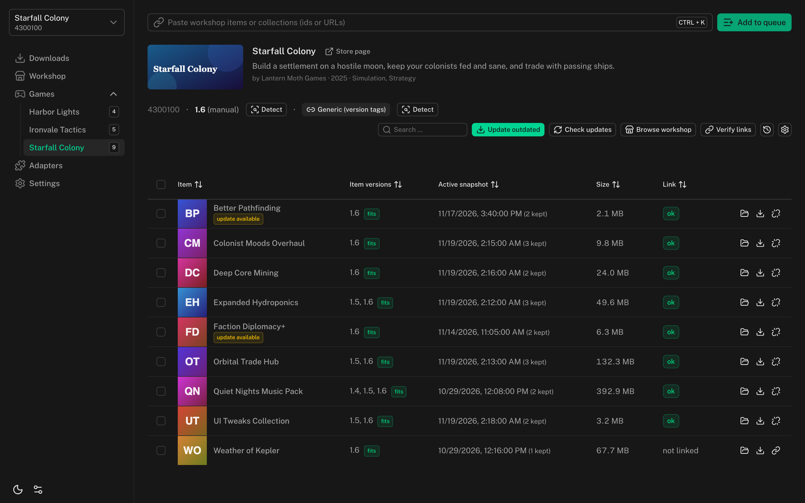
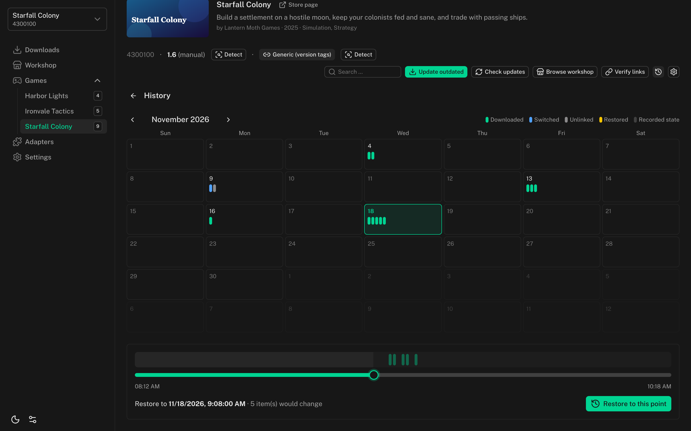
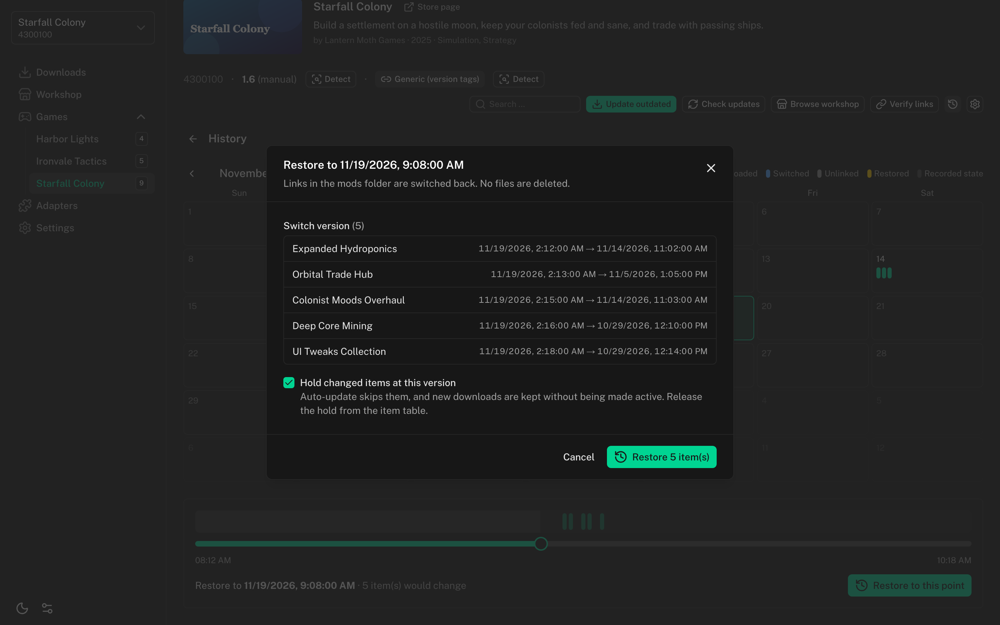
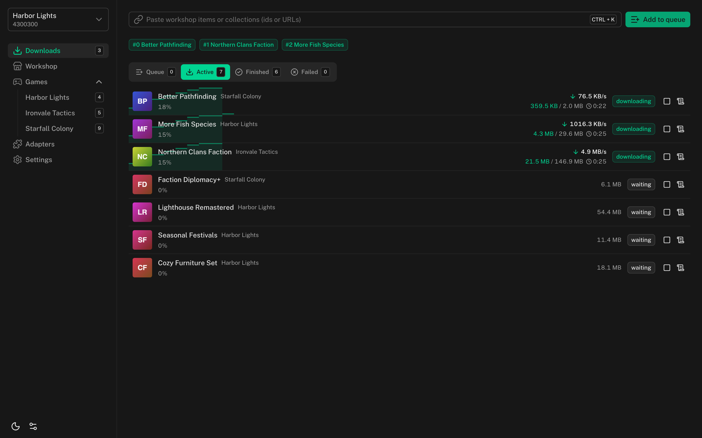
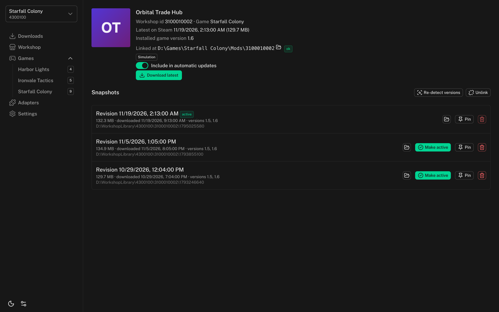
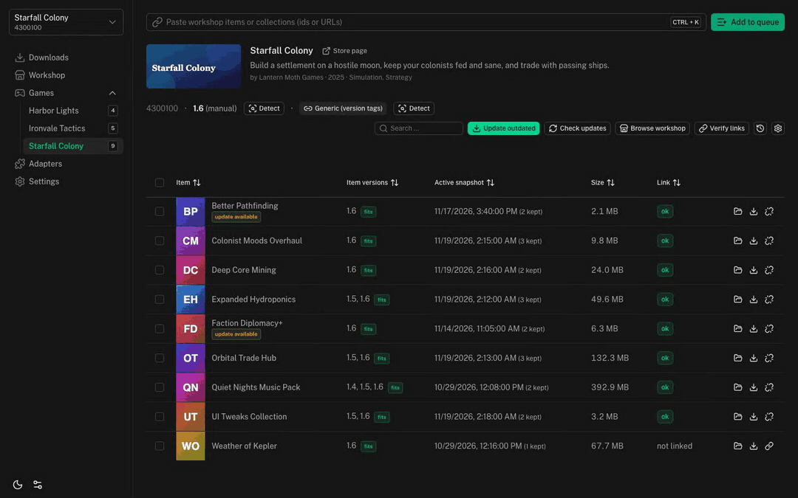
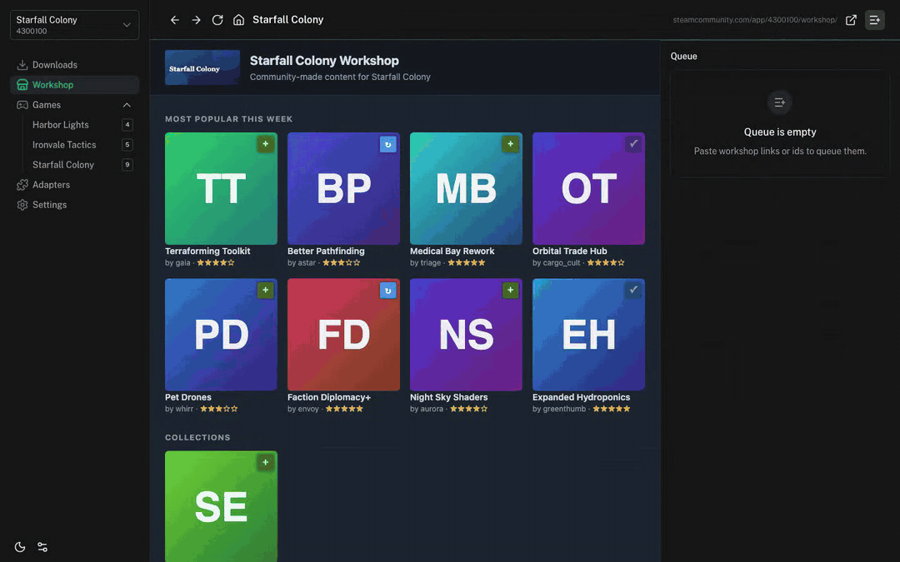
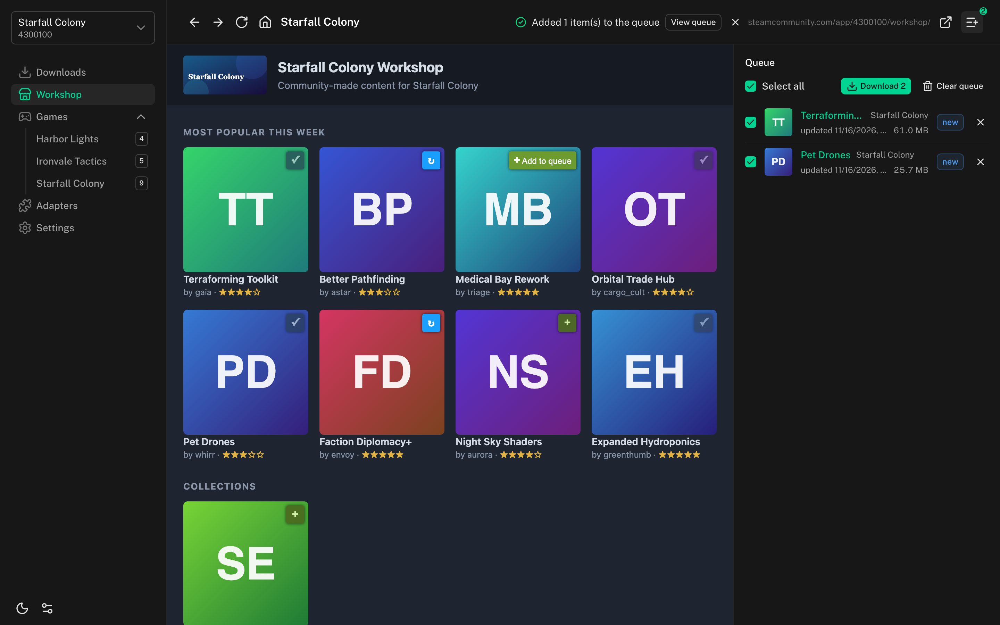
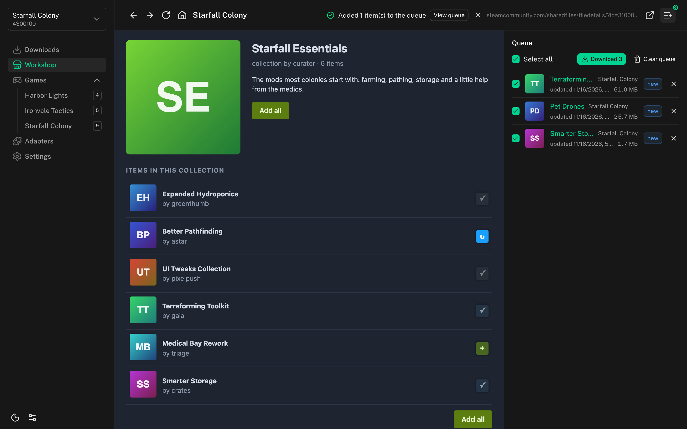
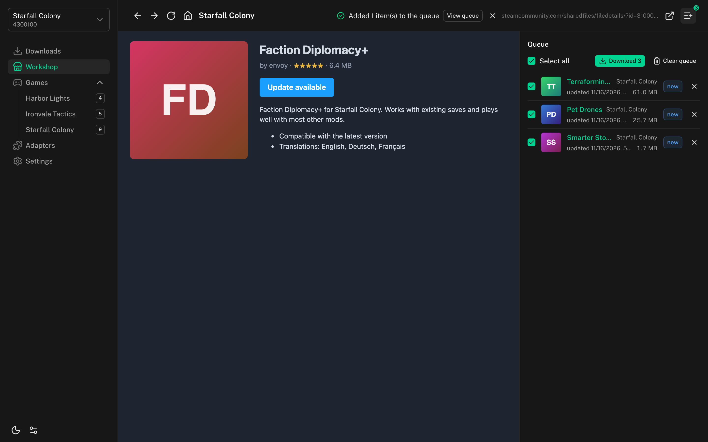

# Workshop Downloader

A Windows desktop app for Steam Workshop mods of games you can't (or don't want to) subscribe to through
Steam, such as dedicated servers or copies bought elsewhere. It downloads items with SteamCMD,
several at a time, keeps every revision it downloads, and links the one you choose into the game's mods
folder. If an update breaks your game, you go back to how things were.



## Features

- **Parallel downloads.** Paste workshop links, collection links or item ids. Items are queued across
  several SteamCMD workers, with live progress, speed and logs per item. Steam accounts and Steam Guard
  are supported for games that don't allow anonymous downloads.
- **Snapshots.** Each downloaded revision is kept in your library folder
  (`<library>\<appId>\<itemId>\<revision>\`). A junction (or symlink) in the game's mods folder points at
  the active one, so switching versions never copies or deletes files.
- **History and restore points.** A calendar shows every download, switch and unlink per game. Pick a day,
  drag to a moment on its timeline, and every item's link goes back to how it was then. Before anything
  changes, a confirmation lists each item that will change.
- **Hold.** Items you restored can be held at their version: auto-update skips them, and new downloads are
  kept without being made active.
- **Update checks.** Check a game (or all of them) against the Steam Web API, update outdated items in one
  click, or let the app check on a timer and queue updates for you.
- **Game version fit.** Adapters read the game's version and the versions each item supports (from files
  or workshop tags) and flag items that don't list your version. RimWorld and Stellaris adapters are built
  in. You can write your own, and a generic adapter covers other games.
- **Workshop browser.** Browse a game's workshop inside the app. Every item tile gets a "+" that adds it to
  the queue, collections get "Add all" (and a "+" per item), and an item's own page gets an "Add to queue"
  button. Items you already have are marked: "✓" when downloaded, "↻" / "Update available" when Steam has a
  newer revision, and "In queue" once queued. The queue sits in a panel beside the browser.
- **Import existing mods.** Folders already in a game's mods folder can be moved into the library as
  snapshots and linked back, without downloading them again.

## Screenshots

| History and restore point | Restore confirmation |
| --- | --- |
|  |  |
| **Downloads** | **An item and its snapshots** |
|  |  |

Undoing this morning's updates:



### Workshop browser

Adding items and a whole collection from the workshop, with the queue alongside:



| Browsing: "+" to add, ✓ downloaded, ↻ update | A collection: "Add all" and per-item "+" |
| --- | --- |
|  |  |
| **An item with an update on Steam** | |
|  | |

The screenshots use made-up games and mods, and the workshop pages in them are plain stand-ins for Steam's,
showing the app's real add buttons and indicators (see [Regenerating the screenshots](#regenerating-the-screenshots)).

## Install

Download the installer from the [latest release](https://github.com/JoshCunningHum/workshop-downloader/releases/latest)
(`.exe` for the NSIS setup or `.msi`) and run it. The app needs Windows 10 or 11 with the WebView2 runtime,
which Windows 11 already has.

On first start, a short setup asks for:

1. **Steam folder**, found automatically when Steam is installed.
2. **Library folder**, where snapshots are kept. Put it on the same drive as your games: junctions only
   work between local NTFS drives.
3. **SteamCMD**, which the app downloads and installs for you.
4. **App list**, the list of games that allow anonymous workshop downloads, used by the game picker.

Then add a game, set its mods folder in the game's settings (or let its adapter fill it in), and paste
some workshop links.

## Development

Built with Nuxt 4, Nuxt UI and Tauri v2. It ships for Windows only, and macOS works as a dev stand-in
(symlinks instead of junctions). See `plans/` for design notes and `HANDOFF.md` for the Windows test
checklist.

Requirements: [bun](https://bun.sh) 1.3+, Rust 1.90+ (`rustup`) and the
[Tauri prerequisites](https://v2.tauri.app/start/prerequisites/) for your OS.

```bash
bun install
bun tauri dev      # builds the fswatch sidecar, starts Nuxt on :3000 and opens the app
```

`bun run dev` alone serves the UI in a browser, but anything that needs Tauri (database, SteamCMD) is
unavailable there. With [just](https://github.com/casey/just) installed, `just` lists the common commands.

| Command | What it does |
| --- | --- |
| `bun run sidecar` | Build `crates/fswatch` and copy it to `src-tauri/binaries/fswatch-<triple>` |
| `bun run db:generate` | Write a SQL migration to `drizzle/` from `app/lib/db/schema.ts` (applied on app start) |
| `bun run test` | Vitest |
| `bun run lint` / `bun run typecheck` | ESLint / vue-tsc |
| `bun run screenshots` | Rebuild the UI and retake the README screenshots and GIF |
| `bun tauri build` | Windows installers (NSIS + MSI) |

### Regenerating the screenshots

`bun run screenshots` builds the static UI, opens it in headless Chromium (Playwright) with the Tauri
backend faked, on a demo database of fictional games, and writes `docs/screenshots/`. The Workshop browser
(a native webview in the app) is stood in for by an iframe running the app's real `workshop_inject.js` on
demo pages served at the Steam Community URLs; nothing is requested from Steam. The GIFs need `ffmpeg` on
your `PATH`. Pass `--skip-build` to reuse `.output/public`. The demo data lives in
`scripts/screenshots/demo-data.ts` and the workshop pages in `scripts/screenshots/workshop-pages.ts`.

### Layout

```
app/                 Nuxt srcDir (pages, components, composables, lib/db, lib/services)
drizzle/             generated SQL migrations
crates/fswatch/      filesystem watcher sidecar (NDJSON over stdio)
src-tauri/           Tauri app; Cargo workspace root (includes ../crates/fswatch)
scripts/             build-sidecar.ts, screenshots/
docs/screenshots/    README images
```

## License

[MIT](LICENSE)
